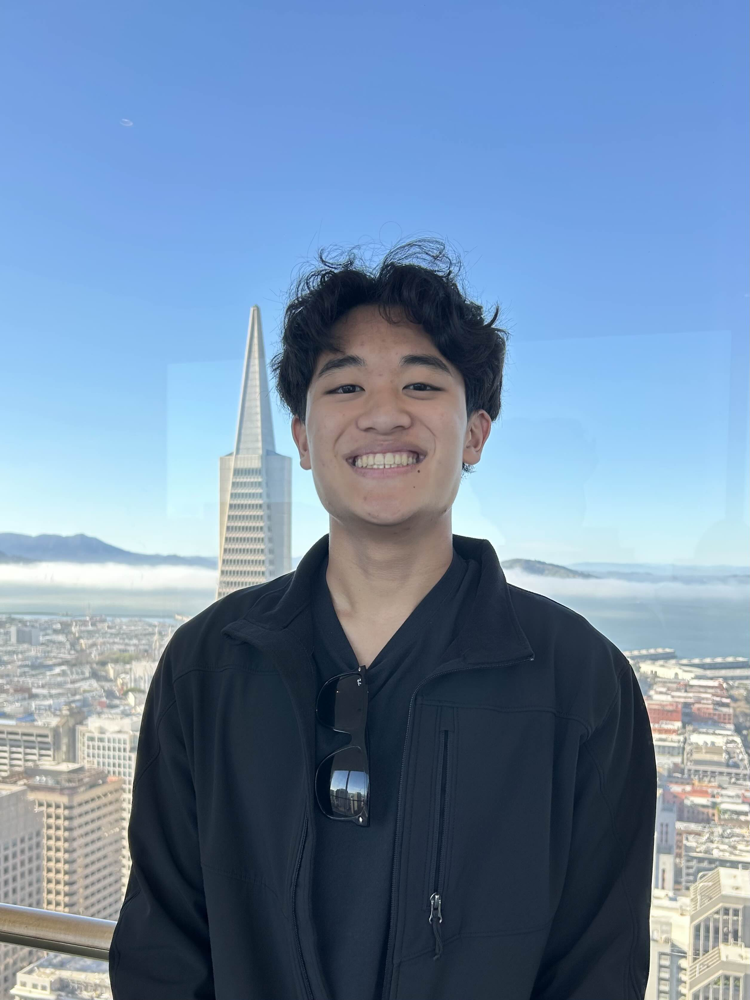
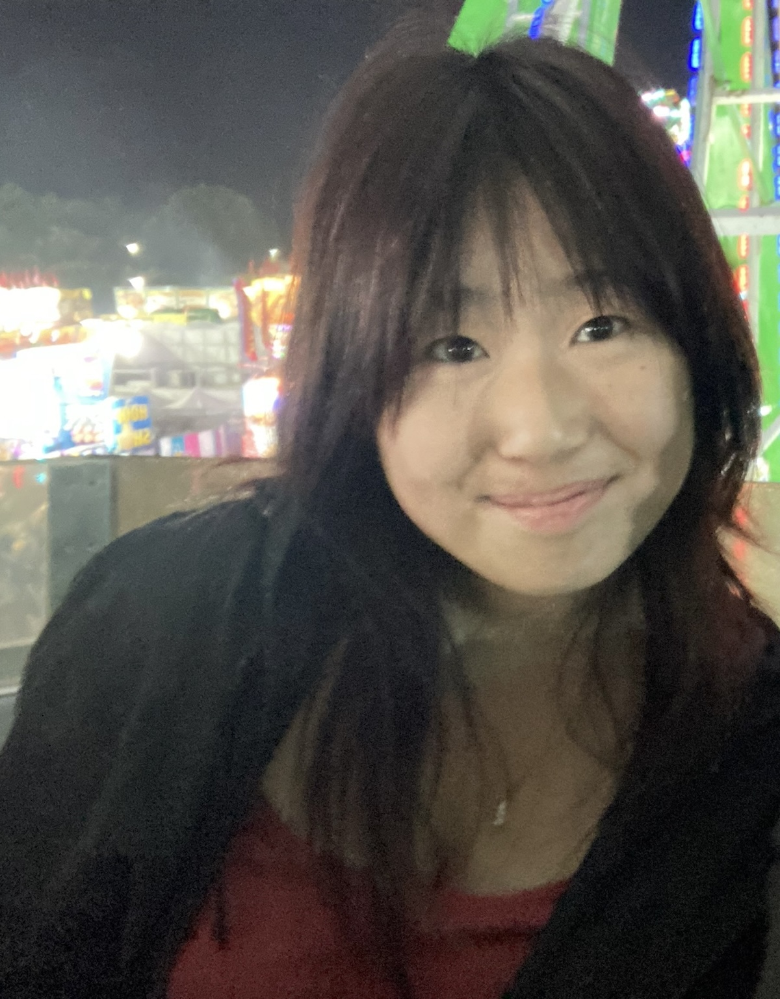
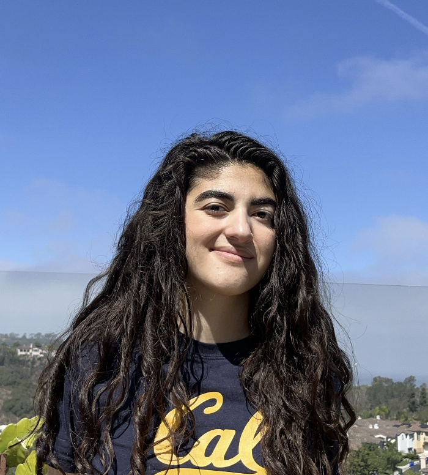
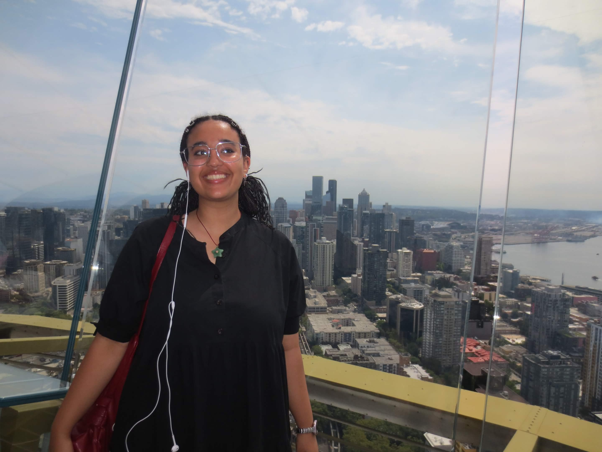
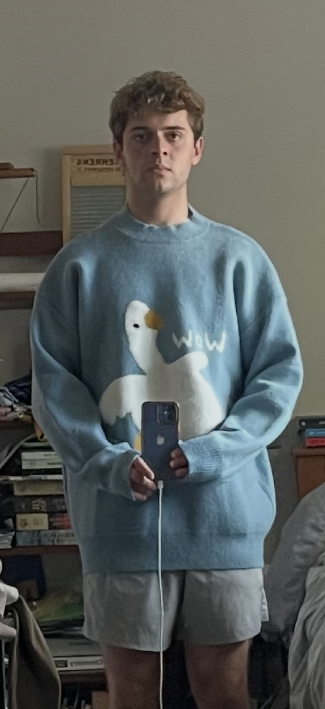
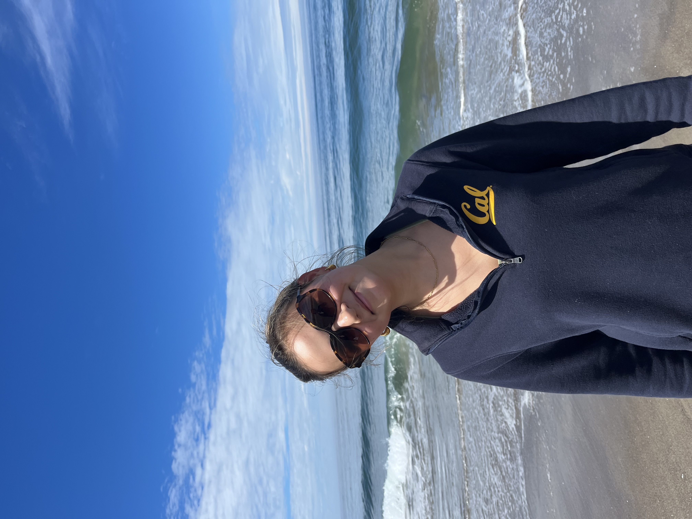
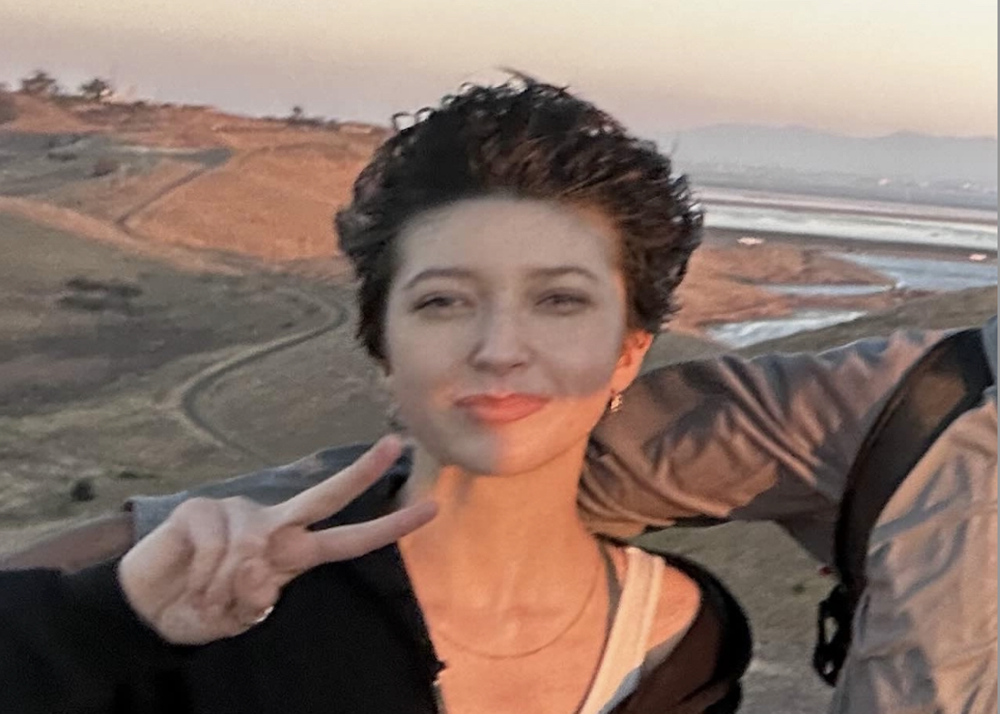

# Current Instructors and Interns

The following is a list of current instructors and interns on the Python DeCal staff. 

  <h2>Meet the Python DeCalTeam</h2>

  

    <!-- Headshots (all instructors + interns) -->
    
    
    
    
    
    
    
    
    
  

  <!-- Caption updates automatically -->
  
Brianna Peck

  

    <button class="rotator-btn" data-target="rotator-team" data-action="prev" aria-label="Previous photo">‹</button>
    <button class="rotator-btn" data-target="rotator-team" data-action="next" aria-label="Next photo">›</button>
  

## Instructors

| Name + Email   | Position(s)                                                         | Favorite Astronomical Object |
|----------------|---------------------------------------------------------------------|------------------------------|
| Katie Mora (katherinemora@berkeley.edu)| Head Instructor (Spring 2026 – Present) Instructor (Spring 2025 – Fall 2025) Intern (Fall 2024)| JWST-ER1 |
| Mariam Helal (mariam.helal@berkeley.edu)| Instructor (Fall 2025 – Present) Intern (Spring 2025)| Io |
| William Lee (williamlee8@berkeley.edu)| Instructor (Fall 2025 – Present) Intern (Spring 2025)| Orion Nebula |
| Milana Berhe (milana.berhe@berkeley.edu)| Instructor (Spring 2026– Present) Intern (Fall 2025)| The Moon |
| Olivia Silvia (olivia_lsilva@berkeley.edu)| Instructor (Spring 2026– Present) Intern (Fall 2025)| Sirius A |
| Annecy Jiang (annecyjiang@berkeley.edu)| Instructor (Fall 2026– Present) Intern (Spring 2026)| - |
| Makaio Jimenez (makaiojimenez@berkeley.edu)| Instructor (Fall 2026– Present) Intern (Spring 2026)| - |
| Nathan DeBeech (nathandebeech@berkeley.edu)| Instructor (Fall 2026– Present) Intern (Spring 2026)| - |

## Interns

| Name + Email  | Position(s)        | Favorite Astronomical Object |
|---------------|--------------------|------------------------------|
| Hannah Eghtedari (hannaheghtedari@berkeley.edu )| Intern (Fall 2026)| - |

## Faculty Sponsor

Aaron Parsons (aparsons@berkeley.edu) (Fall 2025 - Present)

## Previous Instructors and Interns

Check out the amazing people who have helped build and teach the Python DeCal over the years. 

[See past team members →](/docs/instructors/previous-instructors.md)
{: .btn .btn-outline }

